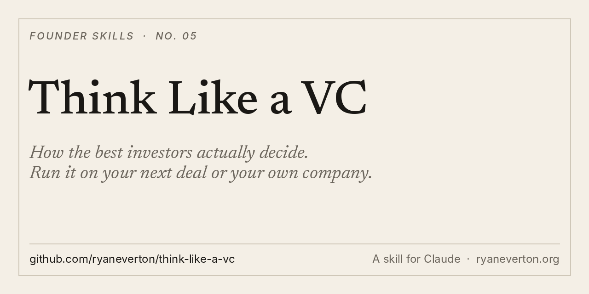

<p align="center"></p>

# Think Like a VC

**How the best VCs actually decide, turned into a skill you can run on your next deal or your own company.**

A skill for Claude and other agents. The companion to my free book, [How to Think Like a VC](https://how-to-think-like-a-vc.netlify.app).

[Install](#install) · [What it makes](#what-it-makes) · [Use it](#use-it) · [Why I built it](#why-i-built-it)

## What it makes

- **Investor mode.** A one-page decision memo, run the way the best partnerships run a Monday meeting: a conviction score from 0 to 10 with no fives allowed, the founder test, the moat test, the "too simple" check, a bias section, a premortem, return-the-fund math and a verdict.
- **Founder mode.** Your company through a partnership's eyes. Where a partner scores you a 9, where another scores you a 1, and what to fix before the meeting.
- **Quickfire.** A verdict in one line. Never "it depends."

## Install

**Claude Code**

```
/plugin marketplace add ryaneverton/think-like-a-vc
/plugin install think-like-a-vc@think-like-a-vc
```

**Any agent (Cursor, Codex, Gemini CLI and more)**

```
npx skills add ryaneverton/think-like-a-vc
```

**Claude app (web and desktop)**

1. Download [think-like-a-vc.zip](https://github.com/ryaneverton/think-like-a-vc/raw/main/dist/think-like-a-vc.zip)
2. In Claude, open **Customize › Skills**, click **+**, then **Create skill › Upload a skill**
3. Upload the ZIP

**Manual**

```
git clone https://github.com/ryaneverton/think-like-a-vc
cp -r think-like-a-vc/skills/think-like-a-vc ~/.claude/skills/
```

## Use it

- "Run think-like-a-vc on this deal." Then paste the deck, memo or notes.
- "Score my company the way a top partnership's Monday meeting would. Where do I get a 1?"
- "Write the bias section and the premortem for my investment in [company]."
- "Can this return the fund? $50M fund, entry at $20M post, we own 8%."
- "Quickfire: should I take this round at a $40M cap?"

## Why I built it

I fed 90+ hours of long-form interviews with the world's best investors into Claude, then spent weeks turning the patterns into a book.

The surprise: they disagree on almost everything that matters. Price, timing, founders, when to sell. But they converge on how they decide. Conviction over consensus. Writing down their own biases. Premortems. Defending every bet in a room that will remember it for a decade.

That shared operating system is what this skill runs. The book is free: [How to Think Like a VC](https://how-to-think-like-a-vc.netlify.app).

## Pairs with

- [leverage-playbook](https://github.com/ryaneverton/leverage-playbook): who makes a business big, and what to offer them
- [gtm-execution-playbook](https://github.com/ryaneverton/gtm-execution-playbook): how to sell it week to week
- [pilot-to-scale-gtm](https://github.com/ryaneverton/pilot-to-scale-gtm): turn pilots into contracts, and contracts into expansion
- [founder-daily-operator](https://github.com/ryaneverton/founder-daily-operator): run several companies with agents, safely

## About

Built by [Ryan Everton](https://ryaneverton.org). I write [The Intuitive Founder](https://ryaneverton.substack.com), on pragmatic AI and the inner work of building something real.

Not investment advice. The skill structures a decision. The decision is yours.

If this helped, star the repo and tell me what you ran it on: [@ryandeverton](https://x.com/ryandeverton).

MIT License.
